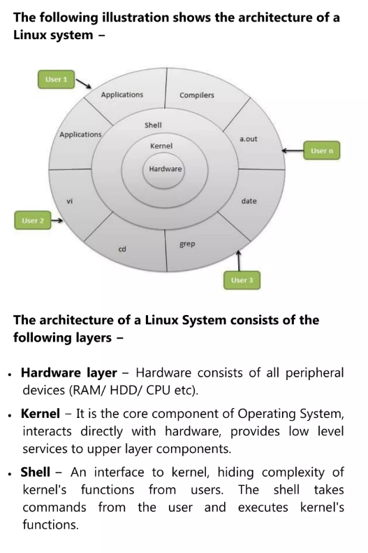

# Day 02 - Linux Architecture, Processes and systemd

Notes from Day 02 of the 90 Days of DevOps challenge, covering the core components of Linux, how processes work, and why systemd matters.

## Table of Contents

- [Linux Architecture](#linux-architecture)
- [Process Management](#process-management)
- [Why systemd Matters](#why-systemd-matters)
- [5 Linux Commands I Would Use Daily](#5-linux-commands-i-would-use-daily)

## Linux Architecture



### 1. Kernel

- The core of the Linux operating system.
- Acts as a bridge between applications and hardware.
- Manages the CPU, memory, devices, and processes.

### 2. User Space

- The area where applications run.
- Examples: Bash, Docker, Nginx, Python.
- Applications communicate with the hardware through the kernel.

### 3. systemd

- The default init system in most Linux distributions.
- Starts and manages services during boot.
- Handles service monitoring and logging.

## Process Management

A **process** is a running instance of a program.

| State | Code | Definition |
|-------|------|------------|
| Running | `R` | Process is currently executing on the CPU (or is ready to run). |
| Sleeping | `S` | Process is waiting for an event or resource. |
| Stopped | `T` | Process has been paused or suspended. |
| Zombie | `Z` | Process has finished execution but still has an entry in the process table. |
| Idle | `I` | Process is waiting for CPU time or user input. |

You can see these states in the `STAT` column of `ps aux` or the `S` column in `top`.

## Why systemd Matters

- Starts services automatically during system boot.
- Manages background services such as Docker, Nginx, and SSH.
- Restarts failed services when configured.

Common commands:

```bash
systemctl status nginx     # check a service's status
systemctl start nginx      # start a service
systemctl enable nginx     # start it automatically at boot
journalctl -u nginx        # view the service's logs
```

## 5 Linux Commands I Would Use Daily

| Command | Application |
|---------|-------------|
| `pwd` | Prints the present working directory. |
| `ls` | Lists all the files and directories in a directory. |
| `mkdir` | Creates a directory. |
| `touch` | Creates an empty file. |
| `cd` | Changes the current directory. |

## Key Takeaways

- The **kernel** sits between applications and hardware.
- **User space** is where your tools and applications run.
- **systemd** boots, supervises, and logs services.
- Every running program is a **process** with a state you can inspect.
