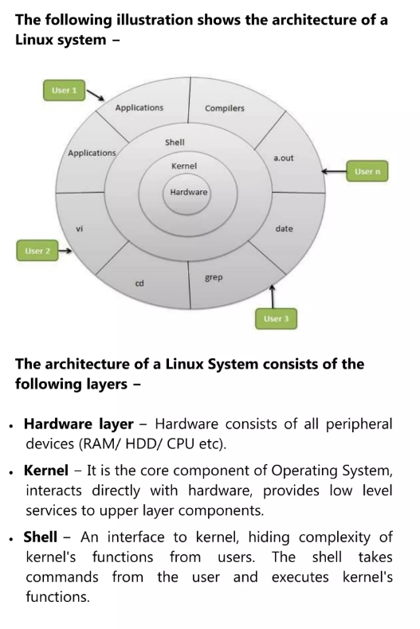

# Day 02 - Linux Architecture, Processes and Systemd

## The Core Component of Linux

```

```

### 1. Kernel

- Core of the Linux Operating System
- Acts as a Bridge Between Application and Hardware.
- Manages CPU, Memory, Devices and Process.


### 2. User Space

- Area where application Run.
- Example: Bash, Docker, Nginx, Python.
- Application Communicate with hardware through the kernel.

### 3. systemd

- Default init System in most linux distribution.
- Starts and manages services during boot.
- Handles services monitoring and logging.

## Process Management
A Process is running instance of a program

| State | Defination |
|-------|------------|
| Running(R) | Process Currently Executing on the CPU.|
| Sleeping(S) | Waiting for an event or resources. |
| Stopped(s) | Process has been pause or suspended. |
| Zombie(Z) | Process has Finished it execution but still has an entry in the process table. |
| Idle | Waiting For CPU time or user input. |

## Why systemd Matters
- Starts services automatically during system boot.
- Manages background services such as Docker, Nginx, and SSH.
- Restarts failed services when configured.

## 5 Linux Commands I Would Use Daily

| Commands | Application |
|----------|-------------|
| pwd | pwd command is used to check "Present Working Directory". |
| ls | ls command is used to list all the files and directory in an directory |
| mkdir | mkdir command is used to create an directory |
| touch | touch command is used to create a file |
| cd | cd command is used to change directory |


