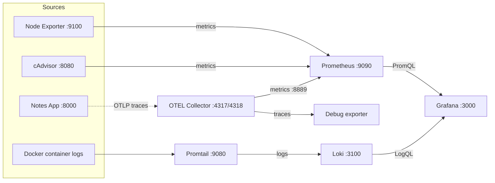

# Observability Stack with Docker Compose

A complete observability setup that runs **8 services with one command** and covers all three pillars of observability: **metrics, logs, and traces**. Built as the Day 77 project of the [#90DaysOfDevOps](https://github.com/TrainWithShubham/90DaysOfDevOps) challenge, using the [observability-for-devops](https://github.com/LondheShubham153/observability-for-devops) reference repository.

> Prometheus + Grafana + Loki + Promtail + OpenTelemetry Collector + Node Exporter + cAdvisor, with a sample app to monitor.

---

## Table of Contents

- [Architecture](#architecture)
- [Services](#services)
- [Prerequisites](#prerequisites)
- [Quick Start](#quick-start)
- [Validation](#validation)
- [Production Overview Dashboard](#production-overview-dashboard)
- [Reference vs My Setup](#reference-vs-my-setup)
- [What I Would Add for Production](#what-i-would-add-for-production)
- [Key Takeaways](#key-takeaways)
- [Clean Up](#clean-up)
- [Credits](#credits)

---

## Architecture



| Pillar | Flow |
|---|---|
| **Metrics** | Node Exporter and cAdvisor are scraped by Prometheus, and Grafana queries Prometheus |
| **Logs** | Promtail reads container logs and pushes them to Loki, and Grafana queries Loki |
| **Traces** | Apps send OTLP data to the OTEL Collector, which prints it with the debug exporter |

---

## Services

| Service | Port | Role |
|---|---|---|
| Prometheus | 9090 | Collects and stores metrics |
| Node Exporter | 9100 | Exposes host metrics (CPU, memory, disk) |
| cAdvisor | 8080 | Exposes per-container metrics |
| Grafana | 3000 | Dashboards for metrics and logs |
| Loki | 3100 | Stores logs |
| Promtail | 9080 | Collects container logs and ships them to Loki |
| OTEL Collector | 4317 / 4318 | Receives OTLP traces and metrics |
| Notes App | 8000 | Sample Django + React app to monitor |

---

## Prerequisites

- [Docker](https://docs.docker.com/get-docker/) with the Compose plugin (`docker compose`)
- Git
- Free ports: `3000`, `3100`, `4317`, `4318`, `8000`, `8080`, `9080`, `9090`, `9100`

---

## Quick Start

```bash
git clone https://github.com/LondheShubham153/observability-for-devops.git
cd observability-for-devops
docker compose up -d
docker compose ps
```

All 8 services should show as running.


### Where to find everything

| Service | URL / Command |
|---|---|
| Prometheus | http://localhost:9090 |
| Node Exporter | `curl http://localhost:9100/metrics \| head -5` |
| cAdvisor | http://localhost:8080 |
| Grafana | http://localhost:3000 (default login `admin` / `admin`, change it after first login) |
| Loki | `curl http://localhost:3100/ready` |
| OTEL Collector | `docker logs otel-collector` |
| Notes App | http://localhost:8000 |

If a service fails to start, check its logs:

```bash
docker compose logs <service-name>
```

---

## Validation

### 1. Metrics

Open http://localhost:9090/targets. All 4 scrape jobs should be **UP**: `prometheus`, `node-exporter`, `cadvisor` (or `docker`), and `otel-collector`.


Useful queries:

```promql
# All targets healthy
up

# Host CPU usage (%)
100 - (avg(rate(node_cpu_seconds_total{mode="idle"}[5m])) * 100)

# Memory usage (%)
(1 - node_memory_MemAvailable_bytes / node_memory_MemTotal_bytes) * 100

# CPU per container
rate(container_cpu_usage_seconds_total{name!=""}[5m]) * 100

# Top 3 memory-hungry containers
topk(3, container_memory_usage_bytes{name!=""})
```

### 2. Logs

Generate some traffic:

```bash
for i in $(seq 1 50); do
  curl -s http://localhost:8000 > /dev/null
  curl -s http://localhost:8000/api/ > /dev/null
done
```

In Grafana, go to **Explore**, choose **Loki**, and try:

```logql
{job="docker"}
{container_name="notes-app"}
{job="docker"} |= "error"
{container_name="notes-app"} |= "GET"
sum by (container_name) (rate({job="docker"}[5m]))
```


### 3. Traces

Send a test trace (a parent span `GET /api/notes` and a child span `SELECT notes FROM database`) to the collector:

```bash
curl -X POST http://localhost:4318/v1/traces \
  -H "Content-Type: application/json" \
  -d '{
    "resourceSpans": [{
      "resource": {
        "attributes": [{ "key": "service.name", "value": { "stringValue": "notes-app" } }]
      },
      "scopeSpans": [{
        "spans": [{
          "traceId": "aaaabbbbccccdddd1111222233334444",
          "spanId": "1111222233334444",
          "name": "GET /api/notes",
          "kind": 2,
          "startTimeUnixNano": "1700000000000000000",
          "endTimeUnixNano": "1700000000150000000",
          "attributes": [
            { "key": "http.method", "value": { "stringValue": "GET" } },
            { "key": "http.route", "value": { "stringValue": "/api/notes" } },
            { "key": "http.status_code", "value": { "intValue": "200" } }
          ],
          "status": { "code": 1 }
        },
        {
          "traceId": "aaaabbbbccccdddd1111222233334444",
          "spanId": "5555666677778888",
          "parentSpanId": "1111222233334444",
          "name": "SELECT notes FROM database",
          "kind": 3,
          "startTimeUnixNano": "1700000000020000000",
          "endTimeUnixNano": "1700000000120000000",
          "attributes": [
            { "key": "db.system", "value": { "stringValue": "sqlite" } },
            { "key": "db.statement", "value": { "stringValue": "SELECT * FROM notes" } }
          ]
        }]
      }]
    }]
  }'
```

Check the collector's debug output:

```bash
docker logs otel-collector 2>&1 | grep -A 20 "GET /api/notes"
```

You should see both spans, their attributes, the parent-child link, and the timing (150 ms for the request, 100 ms for the database query).


---

## Production Overview Dashboard

A single Grafana dashboard, **"Production Overview -- Observability Stack"**, shows metrics and logs together (time range: last 30 minutes, auto-refresh: 10s).

| Row | Panels |
|---|---|
| System Health | CPU gauge, Memory gauge, Disk gauge, Targets Up |
| Container Metrics | Container CPU, Container Memory, Container Count |
| Application Logs | App Logs, Error Rate, Log Volume |
| Service Overview | Prometheus Scrape Duration, OTEL Metrics Received |


<details>
<summary>Panel queries</summary>

**System Health (Prometheus)**

| Panel | Type | Query |
|---|---|---|
| CPU Usage | Gauge | `100 - (avg(rate(node_cpu_seconds_total{mode="idle"}[5m])) * 100)` |
| Memory Usage | Gauge | `(1 - node_memory_MemAvailable_bytes / node_memory_MemTotal_bytes) * 100` |
| Disk Usage | Gauge | `(1 - node_filesystem_avail_bytes{mountpoint="/"} / node_filesystem_size_bytes{mountpoint="/"}) * 100` |
| Targets Up | Stat | `sum(up) / count(up)` |

**Container Metrics (Prometheus)**

| Panel | Type | Query |
|---|---|---|
| Container CPU | Time series | `rate(container_cpu_usage_seconds_total{name!=""}[5m]) * 100` |
| Container Memory | Bar chart | `container_memory_usage_bytes{name!=""} / 1024 / 1024` |
| Container Count | Stat | `count(container_last_seen{name!=""})` |

**Application Logs (Loki)**

| Panel | Type | Query |
|---|---|---|
| App Logs | Logs | `{container_name="notes-app"}` |
| Error Rate | Time series | `sum(rate({job="docker"} \|= "error" [5m]))` |
| Log Volume | Time series | `sum by (container_name) (rate({job="docker"}[5m]))` |

**Service Overview (Prometheus)**

| Panel | Type | Query |
|---|---|---|
| Prometheus Scrape Duration | Time series | `prometheus_target_interval_length_seconds{quantile="0.99"}` |
| OTEL Metrics Received | Stat | `otelcol_receiver_accepted_metric_points` (if available) |

</details>

---

## Reference vs My Setup

I compared the reference repo's configs with the ones I built on Days 73-76.

| Component | Reference repo | My version |
|---|---|---|
| `prometheus.yml` | 4 scrape jobs, 15s interval, no alert rules | Same jobs and interval, adds alert `rule_files` |
| `loki-config.yml` | Basic storage and schema config | Adds a 90-day limit on how old ingested logs can be |
| `promtail-config.yml` | Static file path, `job=docker` label only | Docker service discovery, adds `container_name` label |
| `otel-collector-config.yml` | Debug exporter with `basic` verbosity | `detailed` verbosity |
| `datasources.yml` | Prometheus and Loki provisioned | Same, with `editable: false` |
| `docker-compose.yml` | Dedicated `monitoring` network, read-only mounts | Alert rules, retention limits, SMTP for email alerts, more exposed ports |

Takeaway: my version leans toward alerting and easier debugging, while the reference leans toward tidiness and security.

---

## What I Would Add for Production

- **Alertmanager** to route alerts to Slack or PagerDuty
- **Grafana Tempo** to store traces (the debug exporter only prints them)
- **HTTPS/TLS** on all endpoints
- **Authentication** on Prometheus, and strong Grafana credentials
- **Log retention policies** and storage limits
- **High availability** with multiple Prometheus and Loki replicas
- **Secrets management**, such as a git-ignored `.env` file or a secrets manager, instead of passwords in config files

### Compared with managed tools (Datadog, New Relic, CloudWatch)

| | This stack | Managed tools |
|---|---|---|
| Cost | Free software, but I pay for servers | Paid, often expensive at scale |
| Setup | I build and maintain everything | Ready in minutes |
| Control | Full control over data and config | Limited to what the vendor offers |
| Best for | Learning, small teams, cost control | Teams that want less operational work |

---

## Key Takeaways

1. **Metrics, logs, and traces answer different questions.** Metrics tell me that something is wrong, logs tell me what happened, and traces show where the time went.
2. **Prometheus pulls, Loki receives.** Prometheus scrapes targets, while Promtail pushes logs to Loki.
3. **One interface matters.** With both as Grafana datasources, I can go from a metric spike to the related logs in one place.
4. **Labels make everything queryable.** Labels like `container_name` and `job` keep queries simple.
5. **Docker Compose makes the stack reproducible.** One command brings up all 8 services.
6. **A working demo is not production.** Security, retention, trace storage, alert routing, and high availability are still needed.

---

## Clean Up

```bash
docker compose down -v
```

The `-v` flag also deletes the stored data (Prometheus, Grafana, and Loki volumes), so only run it when you are done.

---

## Credits

- Reference repository: [LondheShubham153/observability-for-devops](https://github.com/LondheShubham153/observability-for-devops)
- Challenge: [TrainWithShubham / 90DaysOfDevOps](https://github.com/TrainWithShubham/90DaysOfDevOps)

`#90DaysOfDevOps` `#DevOpsKaJosh` `#TrainWithShubham`
