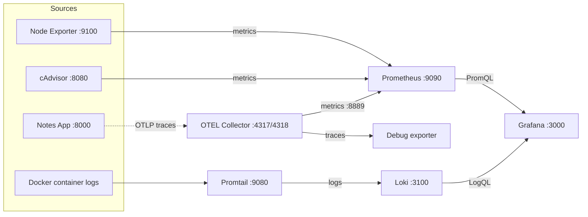

# Day 77 -- Observability Project: Full Stack with Docker Compose

Over the last four days I built the pieces of an observability stack one at a time: Prometheus, Node Exporter, cAdvisor, Grafana, Loki, Promtail, the OpenTelemetry Collector, and alerting. Today I put everything together by running the complete 8-service stack from the `observability-for-devops` reference repository and validating metrics, logs, and traces end to end.

## Contents

- [Architecture Overview](#architecture-overview)
- [Task 1: Clone and Launch the Reference Stack](#task-1-clone-and-launch-the-reference-stack)
- [Task 2: Validate the Metrics Pipeline](#task-2-validate-the-metrics-pipeline)
- [Task 3: Validate the Logs Pipeline](#task-3-validate-the-logs-pipeline)
- [Task 4: Validate the Traces Pipeline](#task-4-validate-the-traces-pipeline)
- [Task 5: Build the Unified Production Overview Dashboard](#task-5-build-the-unified-production-overview-dashboard)
- [Task 6: Compare with the Reference and Document](#task-6-compare-with-the-reference-and-document)
- [Config Files](#config-files)
- [Clean Up](#clean-up)

---

## Architecture Overview

### Services

| Service | Port | Role |
|---|---|---|
| Prometheus | 9090 | Collects and stores metrics |
| Node Exporter | 9100 | Exposes host metrics (CPU, memory, disk) |
| cAdvisor | 8080 | Exposes per-container metrics |
| Grafana | 3000 | Dashboards for metrics and logs |
| Loki | 3100 | Stores logs |
| Promtail | 9080 | Collects container logs and ships them to Loki |
| OTEL Collector | 4317 / 4318 | Receives OTLP traces and metrics |
| Notes App | 8000 | Sample Django + React app to monitor |

### Data flow



- **Metrics:** Node Exporter and cAdvisor are scraped by Prometheus, and Grafana queries Prometheus.
- **Logs:** Promtail reads container logs and pushes them to Loki, and Grafana queries Loki.
- **Traces:** Apps send OTLP data to the OTEL Collector, which prints it with the debug exporter.

---

## Task 1: Clone and Launch the Reference Stack

### What I did

Cloned the reference repo and looked at its structure:

```bash
git clone https://github.com/LondheShubham153/observability-for-devops.git
cd observability-for-devops
tree -I 'node_modules|build|staticfiles|__pycache__'
```

Started the whole stack in the background and checked the containers:

```bash
docker compose up -d
docker compose ps
```

### Service checks

| Service | Port | Check |
|---|---|---|
| Prometheus | 9090 | `http://localhost:9090` |
| Node Exporter | 9100 | `curl http://localhost:9100/metrics \| head -5` |
| cAdvisor | 8080 | `http://localhost:8080` |
| Grafana | 3000 | `http://localhost:3000` |
| Loki | 3100 | `curl http://localhost:3100/ready` |
| Promtail | 9080 | Internal only |
| OTEL Collector | 4317/4318 | `docker logs otel-collector` |
| Notes App | 8000 | `http://localhost:8000` |

### Result

All 8 services were running.

**Screenshot: `docker compose ps`**


---

## Task 2: Validate the Metrics Pipeline

### What I did

Opened `http://localhost:9090/targets` and confirmed all 4 scrape jobs were **UP**:

| Job | Monitors |
|---|---|
| `prometheus` | Prometheus itself |
| `node-exporter` | Host metrics |
| `cadvisor` | Container metrics |
| `otel-collector` | OTLP metrics |

**Screenshot: Prometheus Targets, all jobs UP**


### Validation queries

```promql
# All targets are healthy
up

# Host CPU usage (%)
100 - (avg(rate(node_cpu_seconds_total{mode="idle"}[5m])) * 100)

# Memory usage (%)
(1 - node_memory_MemAvailable_bytes / node_memory_MemTotal_bytes) * 100

# Container CPU per container
rate(container_cpu_usage_seconds_total{name!=""}[5m]) * 100

# Top 3 memory-hungry containers
topk(3, container_memory_usage_bytes{name!=""})
```

### prometheus.yml comparison

| | Reference repo | My version |
|---|---|---|
| Scrape jobs | `prometheus`, `docker`, `node-exporter`, `otel-collector` | `prometheus`, `node-exporter`, `cadvisor`, `otel-collector` |
| Scrape interval | 15s | 15s |
| Alert rules | None | `rule_files` pointing to `alert-rules.yml` |

The jobs and intervals are the same. The only differences are the cAdvisor job name (`docker` vs `cadvisor`) and that my version loads alert rules.

---

## Task 3: Validate the Logs Pipeline

### What I did

Generated traffic so there were logs to see:

```bash
for i in $(seq 1 50); do
  curl -s http://localhost:8000 > /dev/null
  curl -s http://localhost:8000/api/ > /dev/null
done
```

Then opened Grafana, went to **Explore**, selected **Loki**, and ran these LogQL queries:

```logql
# All container logs
{job="docker"}

# Only notes-app logs
{container_name="notes-app"}

# Errors across all containers
{job="docker"} |= "error"

# HTTP request logs from the app
{container_name="notes-app"} |= "GET"

# Rate of log lines per container
sum by (container_name) (rate({job="docker"}[5m]))
```

Checked which log sources Promtail was watching:

```bash
curl -s http://localhost:9080/targets | head -30
```

**Screenshot: Grafana Explore showing Loki logs**


### promtail-config.yml comparison

| | Reference repo | My version |
|---|---|---|
| Discovery | `static_configs` reading `/var/lib/docker/containers/*/*-json.log` | `docker_sd_configs` using the Docker socket |
| Refresh | Not applicable | Every 5s |
| Labels | `job=docker` only | `job=docker` plus `container_name` |

My version finds containers automatically and adds a readable `container_name` label, which makes queries like `{container_name="notes-app"}` possible.

---

## Task 4: Validate the Traces Pipeline

### What I did

Sent a two-span trace to the OTEL Collector over OTLP/HTTP. The trace has a parent span (`GET /api/notes`) and a child span (`SELECT notes FROM database`) that is linked to it through `parentSpanId`.

```bash
curl -X POST http://localhost:4318/v1/traces \
  -H "Content-Type: application/json" \
  -d '{
    "resourceSpans": [{
      "resource": {
        "attributes": [{
          "key": "service.name",
          "value": { "stringValue": "notes-app" }
        }]
      },
      "scopeSpans": [{
        "spans": [{
          "traceId": "aaaabbbbccccdddd1111222233334444",
          "spanId": "1111222233334444",
          "name": "GET /api/notes",
          "kind": 2,
          "startTimeUnixNano": "1700000000000000000",
          "endTimeUnixNano": "1700000000150000000",
          "attributes": [
            { "key": "http.method", "value": { "stringValue": "GET" } },
            { "key": "http.route", "value": { "stringValue": "/api/notes" } },
            { "key": "http.status_code", "value": { "intValue": "200" } }
          ],
          "status": { "code": 1 }
        },
        {
          "traceId": "aaaabbbbccccdddd1111222233334444",
          "spanId": "5555666677778888",
          "parentSpanId": "1111222233334444",
          "name": "SELECT notes FROM database",
          "kind": 3,
          "startTimeUnixNano": "1700000000020000000",
          "endTimeUnixNano": "1700000000120000000",
          "attributes": [
            { "key": "db.system", "value": { "stringValue": "sqlite" } },
            { "key": "db.statement", "value": { "stringValue": "SELECT * FROM notes" } }
          ]
        }]
      }]
    }]
  }'
```

Checked the collector's debug output:

```bash
docker logs otel-collector 2>&1 | grep -A 20 "GET /api/notes"
```

### Result

The output showed both spans with their attributes, the parent-child link (the child's parent ID matches the first span's ID), and timing: 150 ms for the request and 100 ms for the database query.

**Screenshot: OTEL trace in collector debug output**


### otel-collector-config.yml comparison

| | Reference repo | My version |
|---|---|---|
| Debug exporter verbosity | `basic` | `detailed` |
| Other differences | None that change behavior | Formatting only (`batch: {}`, quotes) |

My version prints full span details, which is more useful when debugging.

---

## Task 5: Build the Unified Production Overview Dashboard

### What I did

Created a Grafana dashboard named **"Production Overview -- Observability Stack"** with four rows, a **Last 30 minutes** time range, and **10s** auto-refresh.

**Row 1: System Health (Prometheus)**

| Panel | Type | Query |
|---|---|---|
| CPU Usage | Gauge | `100 - (avg(rate(node_cpu_seconds_total{mode="idle"}[5m])) * 100)` |
| Memory Usage | Gauge | `(1 - node_memory_MemAvailable_bytes / node_memory_MemTotal_bytes) * 100` |
| Disk Usage | Gauge | `(1 - node_filesystem_avail_bytes{mountpoint="/"} / node_filesystem_size_bytes{mountpoint="/"}) * 100` |
| Targets Up | Stat | `sum(up) / count(up)` |

**Row 2: Container Metrics (Prometheus)**

| Panel | Type | Query |
|---|---|---|
| Container CPU | Time series | `rate(container_cpu_usage_seconds_total{name!=""}[5m]) * 100` (legend: `{{name}}`) |
| Container Memory | Bar chart | `container_memory_usage_bytes{name!=""} / 1024 / 1024` (legend: `{{name}}`) |
| Container Count | Stat | `count(container_last_seen{name!=""})` |

**Row 3: Application Logs (Loki)**

| Panel | Type | Query |
|---|---|---|
| App Logs | Logs | `{container_name="notes-app"}` |
| Error Rate | Time series | `sum(rate({job="docker"} \|= "error" [5m]))` |
| Log Volume | Time series | `sum by (container_name) (rate({job="docker"}[5m]))` |

**Row 4: Service Overview (Prometheus)**

| Panel | Type | Query |
|---|---|---|
| Prometheus Scrape Duration | Time series | `prometheus_target_interval_length_seconds{quantile="0.99"}` |
| OTEL Metrics Received | Stat | `otelcol_receiver_accepted_metric_points` (if available) |

**Screenshot: Production Overview dashboard**


---

## Task 6: Compare with the Reference and Document

### 6.1 Config comparison

| Component | Reference repo | My version | Key differences |
|---|---|---|---|
| `prometheus.yml` | 4 scrape jobs, 15s, no alert rules, cAdvisor job named `docker` | Same jobs and interval, adds `rule_files`, cAdvisor job named `cadvisor` | Mine supports alerting |
| `loki-config.yml` | Basic storage and schema config | Same, plus `limits_config` rejecting samples older than 90 days (2160h) | Mine adds an ingest age limit |
| `promtail-config.yml` | `static_configs` with `job=docker` only | `docker_sd_configs` with `container_name` label | Mine discovers containers automatically |
| `otel-collector-config.yml` | Debug exporter, `verbosity: basic` | Debug exporter, `verbosity: detailed` | Mine prints full span details |
| `datasources.yml` | Prometheus and Loki provisioned | Same, with `editable: false` | Mine blocks UI edits to datasources |
| `docker-compose.yml` | See below | See below | See below |

### docker-compose.yml differences

| Area | Reference | Mine |
|---|---|---|
| Network | Dedicated `monitoring` bridge network | Default Compose network |
| Notes app | Built from local `./notes-app` | Pulled from Docker Hub (`trainwithshubham/notes-app`) |
| Prometheus | Config mounted read-only | Mounts `alert-rules.yml`, sets 30d / 1GB retention |
| Node Exporter | Uses `pid: host` | No `pid: host` |
| cAdvisor | Mounts Docker socket | `privileged: true` with `/dev/kmsg` and `/dev/disk` |
| Grafana | Mounts datasources and dashboards separately | Mounts whole `provisioning` folder, sets admin credentials, SMTP for email alerts |
| Promtail | `depends_on: loki`, no exposed port | Exposes port 9080 |
| OTEL Collector | Port 8889 internal only | Port 8889 published to the host |

**What I learned from the comparison**

- My version leans toward alerting and easier debugging (alert rules, SMTP, detailed trace output, exposed ports).
- The reference leans toward tidiness and security (read-only mounts, dedicated network, fewer exposed ports).
- `reject_old_samples_max_age` is not a real retention policy. It only blocks old logs at ingest. Actual retention needs Loki's compactor and retention settings.

### 6.2 Concepts mapped to days

| Day | What I built |
|---|---|
| 73 | Prometheus, PromQL, metrics fundamentals |
| 74 | Node Exporter, cAdvisor, Grafana dashboards |
| 75 | Loki, Promtail, LogQL, log-metric correlation |
| 76 | OTEL Collector, traces, alerting rules |
| 77 | Full stack integration, unified dashboard |

### 6.3 What I would add for production

- **Alertmanager** to route alerts to Slack or PagerDuty so a person is actually notified.
- **Grafana Tempo** to store traces. The debug exporter only prints them, so they are lost.
- **HTTPS/TLS** on all endpoints to encrypt traffic.
- **Authentication** on Prometheus, which has no login by default, and strong Grafana credentials instead of defaults.
- **Log retention policies and storage limits** so old logs are deleted and disks do not fill up.
- **High availability** with multiple Prometheus and Loki replicas so one crash does not mean lost monitoring.
- **Secrets management** (a `.env` file kept out of git, or a secrets manager) instead of passwords in config files.

### 6.4 This stack vs managed solutions (Datadog, New Relic, CloudWatch)

| | This stack (open source) | Managed tools |
|---|---|---|
| Cost | Software is free, but I pay for servers | Paid, often expensive at scale |
| Setup | I build and maintain everything | Ready in minutes |
| Control | Full control over data and config | Limited to what the vendor offers |
| Maintenance | I handle upgrades and scaling | Vendor handles it |
| Best for | Learning, small teams, cost control | Teams that want less operational work |

### 6.5 Key takeaways from the 5-day observability block

1. **Metrics, logs, and traces answer different questions.** Metrics tell me that something is wrong, logs tell me what happened, and traces show where in a request the time went.
2. **Prometheus pulls, Loki receives.** Prometheus scrapes targets on an interval, while Promtail pushes logs to Loki.
3. **One interface matters.** Having Prometheus and Loki as Grafana datasources lets me move from a metric spike to the related logs in one place.
4. **Labels make everything queryable.** Good labels such as `container_name` and `job` make PromQL and LogQL queries simple.
5. **Docker Compose makes the whole stack reproducible.** One command brings up all 8 services.
6. **Production needs more than a working demo.** Security, retention, trace storage, alert routing, and high availability are all still needed.

---

## Config Files

> Note: Secrets are not included. The Grafana SMTP password is read from a `.env` file (`SMTP_PASSWORD`), which is listed in `.gitignore`.

### docker-compose.yml

```yaml
services:
  prometheus:
    image: prom/prometheus:latest
    container_name: prometheus
    ports:
      - "9090:9090"
    volumes:
      - ./prometheus.yml:/etc/prometheus/prometheus.yml
      - ./alert-rules.yml:/etc/prometheus/alert-rules.yml
      - prometheus_data:/prometheus
    command:
      - '--config.file=/etc/prometheus/prometheus.yml'
      - '--storage.tsdb.retention.time=30d'
      - '--storage.tsdb.retention.size=1GB'
    restart: unless-stopped

  node-exporter:
    image: prom/node-exporter:latest
    container_name: node-exporter
    ports:
      - "9100:9100"
    volumes:
      - /proc:/host/proc:ro
      - /sys:/host/sys:ro
      - /:/rootfs:ro
    command:
      - '--path.procfs=/host/proc'
      - '--path.sysfs=/host/sys'
      - '--path.rootfs=/rootfs'
      - '--collector.filesystem.mount-points-exclude=^/(sys|proc|dev|host|etc)($$|/)'
    restart: unless-stopped

  notes-app:
    image: trainwithshubham/notes-app:latest
    container_name: notes-app
    ports:
      - "8000:8000"
    restart: unless-stopped

  cadvisor:
    image: gcr.io/cadvisor/cadvisor:latest
    container_name: cadvisor
    privileged: true
    ports:
      - "8080:8080"
    volumes:
      - /:/rootfs:ro
      - /var/run:/var/run:ro
      - /sys:/sys:ro
      - /var/lib/docker/:/var/lib/docker:ro
      - /dev/disk/:/dev/disk:ro
    devices:
      - /dev/kmsg
    restart: unless-stopped

  grafana:
    image: grafana/grafana-enterprise:latest
    container_name: grafana
    ports:
      - "3000:3000"
    volumes:
      - grafana_data:/var/lib/grafana
      - ./grafana/provisioning:/etc/grafana/provisioning
    environment:
      - GF_SECURITY_ADMIN_USER=admin
      - GF_SECURITY_ADMIN_PASSWORD=${GRAFANA_ADMIN_PASSWORD}
      - GF_SMTP_ENABLED=true
      - GF_SMTP_HOST=smtp.gmail.com:587
      - GF_SMTP_USER=your-email@gmail.com
      - GF_SMTP_PASSWORD=${SMTP_PASSWORD}
      - GF_SMTP_FROM_ADDRESS=your-email@gmail.com
      - GF_SMTP_FROM_NAME=Grafana Alerts
    restart: unless-stopped

  loki:
    image: grafana/loki:latest
    container_name: loki
    ports:
      - "3100:3100"
    volumes:
      - ./loki/loki-config.yml:/etc/loki/loki-config.yml
      - loki_data:/loki
    command: -config.file=/etc/loki/loki-config.yml
    restart: unless-stopped

  promtail:
    image: grafana/promtail:latest
    container_name: promtail
    ports:
      - "9080:9080"
    volumes:
      - ./promtail/promtail-config.yml:/etc/promtail/promtail-config.yml
      - /var/lib/docker/containers:/var/lib/docker/containers:ro
      - /var/run/docker.sock:/var/run/docker.sock
    command: -config.file=/etc/promtail/promtail-config.yml
    restart: unless-stopped

  otel-collector:
    image: otel/opentelemetry-collector-contrib:latest
    container_name: otel-collector
    ports:
      - "4317:4317"   # OTLP gRPC
      - "4318:4318"   # OTLP HTTP
      - "8889:8889"   # Prometheus exporter
    volumes:
      - ./otel-collector/otel-collector-config.yml:/etc/otelcol-contrib/config.yaml
    restart: unless-stopped

volumes:
  prometheus_data:
  grafana_data:
  loki_data:
```

### prometheus.yml

```yaml
global:
  scrape_interval: 15s
  evaluation_interval: 15s

rule_files:
  - /etc/prometheus/alert-rules.yml

scrape_configs:
  - job_name: "prometheus"
    static_configs:
      - targets: ["localhost:9090"]

  - job_name: "node-exporter"
    static_configs:
      - targets: ["node-exporter:9100"]

  - job_name: "cadvisor"
    static_configs:
      - targets: ["cadvisor:8080"]

  - job_name: "otel-collector"
    static_configs:
      - targets: ["otel-collector:8889"]
```

### loki-config.yml

```yaml
auth_enabled: false

server:
  http_listen_port: 3100

common:
  ring:
    instance_addr: 127.0.0.1
    kvstore:
      store: inmemory
  replication_factor: 1
  path_prefix: /loki

schema_config:
  configs:
    - from: "2020-10-24"
      store: tsdb
      object_store: filesystem
      schema: v13
      index:
        prefix: index_
        period: 24h

storage_config:
  filesystem:
    directory: /loki/chunks

```

### promtail-config.yml

```yaml

server:
  http_listen_port: 9080
  grpc_listen_port: 0

positions:
  filename: /tmp/positions.yaml

clients:
  - url: http://loki:3100/loki/api/v1/push

scrape_configs:
  - job_name: docker
    static_configs:
      - targets:
          - localhost
        labels:
          job: docker
          __path__: /var/lib/docker/containers/*/*-json.log
    pipeline_stages:
      - docker: {}

```

### otel-collector-config.yml

```yaml
receivers:
  otlp:
    protocols:
      grpc:
        endpoint: 0.0.0.0:4317
      http:
        endpoint: 0.0.0.0:4318

processors:
  batch: {}

exporters:
  prometheus:
    endpoint: 0.0.0.0:8889
  debug:
    verbosity: basic

service:
  pipelines:
    metrics:
      receivers: [otlp]
      processors: [batch]
      exporters: [prometheus]
    traces:
      receivers: [otlp]
      processors: [batch]
      exporters: [debug]
    logs:
      receivers: [otlp]
      processors: [batch]
      exporters: [debug]

```

---

## Clean Up

```bash
docker compose down -v
```

The `-v` flag also removes the named volumes (Prometheus, Grafana, and Loki data), so I only ran this after finishing and taking all screenshots.
