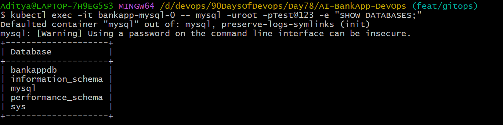
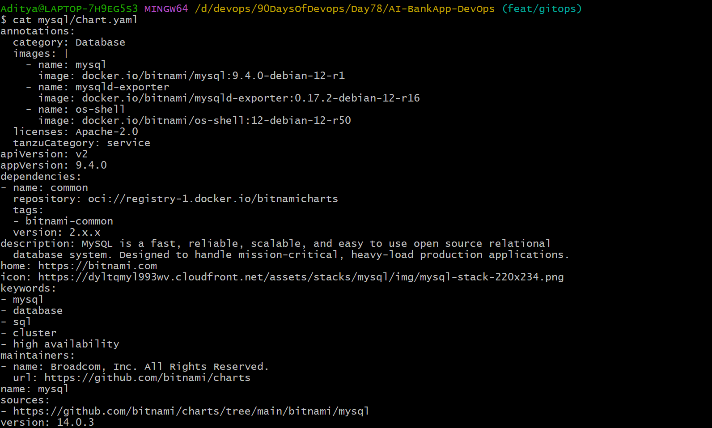

# Day 78 – Introduction to Helm and Chart Basics

Part of my **#90DaysOfDevOps** journey with TrainWithShubham. Today I moved from hand-written Kubernetes manifests to **Helm**, the package manager for Kubernetes, using the [AI-BankApp-DevOps](https://github.com/TrainWithShubham/AI-BankApp-DevOps) project (branch `feat/gitops`) as the reference.

📄 **Full notes with every command and explanation:** [day-78-helm-intro.md](./day-78-helm-intro.md)

## Environment

| Item | Value |
|---|---|
| Cluster | Kind `tws-cluster` (1 control-plane + 2 workers) |
| Helm | v3 |
| Chart | `bitnami/mysql` `14.0.3` (app version `9.4.0`) |
| Second app | `bitnami/nginx` |

## What I did

| Task | Topic | Outcome |
|---|---|---|
| 1 | Helm concepts | Chart, release, repository, values; why Helm beats raw manifests |
| 2 | Install Helm, explore AI-BankApp | Kind cluster running, Helm connected, 12 raw manifests reviewed |
| 3 | Deploy MySQL with a chart | One command replaced 5 YAML files; fixed an `ImagePullBackOff` |
| 4 | Values files | Wrote `mysql-values.yaml`, ran two releases of one chart |
| 5 | Upgrade, rollback, uninstall | Enabled metrics, rolled back, read revision history |
| 6 | Chart structure | Pulled the chart, read templates, rendered with `helm template` |

## Quick start

```bash
# Cluster
git clone -b feat/gitops https://github.com/TrainWithShubham/AI-BankApp-DevOps.git
cd AI-BankApp-DevOps
kind create cluster --config setup-k8s/kind-config.yml

# Helm repo
helm repo add bitnami https://charts.bitnami.com/bitnami
helm repo update

# Deploy MySQL with a values file
helm install bankapp-mysql bitnami/mysql -f mysql-values.yaml

# Release management
helm upgrade bankapp-mysql bitnami/mysql --reuse-values --set metrics.enabled=true
helm history bankapp-mysql
helm rollback bankapp-mysql 1

# Clean up
helm uninstall bankapp-mysql
kubectl delete pvc -l app.kubernetes.io/instance=bankapp-mysql
```

## Screenshots

**Kind cluster nodes**


**The 12 raw manifests in `k8s/`**


**Helm repo added and MySQL chart found**


**The `ImagePullBackOff` error**


**MySQL running after the fix**


**`bankappdb` created**



**Two releases of the same chart**


**Pod with 2 containers after enabling metrics**


**Revision history: install, upgrade, rollback**


**Chart structure and `Chart.yaml`**



## Problem solved: `ImagePullBackOff`

`helm install` reported `deployed`, but the MySQL pod could not pull its image:

```
Failed to pull image "docker.io/bitnami/mysql:9.4.0-debian-12-r1": ... not found
```

**Cause:** since August 2025 Bitnami moved most free images from `docker.io/bitnami/*` to `docker.io/bitnamilegacy/*`.

**Fix:**

```bash
--set image.repository=bitnamilegacy/mysql \
--set global.security.allowInsecureImages=true
```

(The metrics sidecar needs `metrics.image.repository=bitnamilegacy/mysqld-exporter` as well.)

## Key takeaways

1. A **chart** is a blueprint, a **release** is an installed instance, **values** customize it.
2. `helm upgrade` resets values you don't pass again. Use `--reuse-values` or pass the full values file.
3. `helm rollback` creates a **new revision**; it reverts configuration, not data.
4. Helm does not delete StatefulSet PVCs on uninstall, so clean them up manually.
5. A successful `helm install` doesn't mean the app is healthy. Always check the pods.
6. `chart version` is the version of the chart itself; `appVersion` is the version of the app inside it (MySQL).
7. `helm template` and `helm show values` are the best tools for understanding and debugging a chart.

## Why the AI-BankApp should become a Helm chart

- One chart with `values-dev.yaml`, `values-staging.yaml` and `values-prod.yaml`
- Image tag changed in one place instead of editing deployment files
- Versioned releases with built-in rollback
- MySQL as a subchart dependency
- Shared labels and names in `_helpers.tpl`
- Optional components (HPA, Ollama, cert-manager) toggled with `if` conditions

**Next up (Day 79):** convert the AI-BankApp's 12 raw manifests into a proper Helm chart.

---

`#90DaysOfDevOps` `#DevOpsKaJosh` `#TrainWithShubham`
