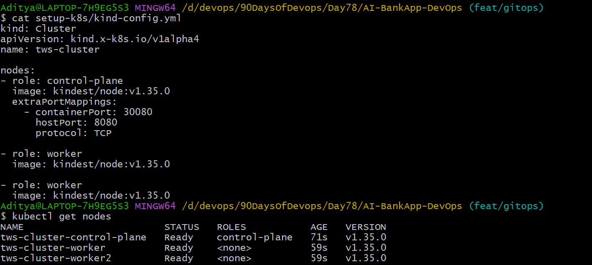
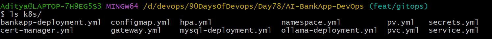
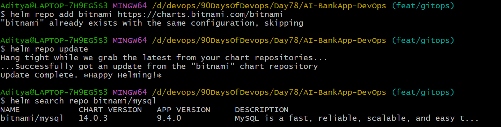
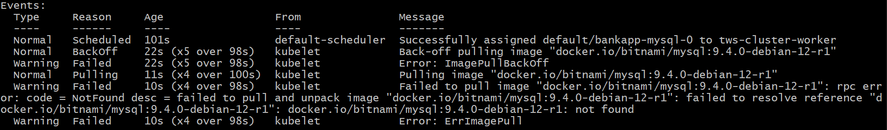
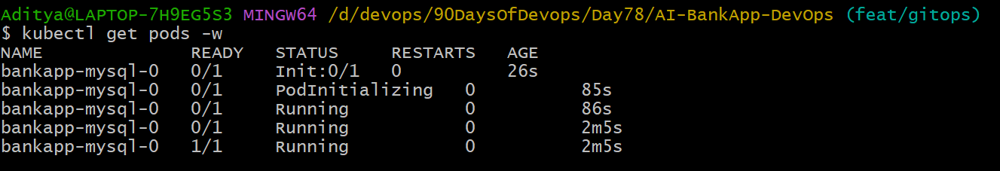
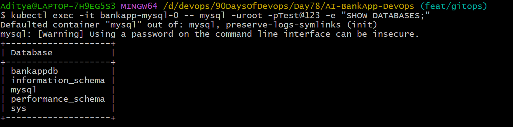
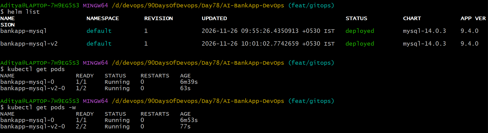
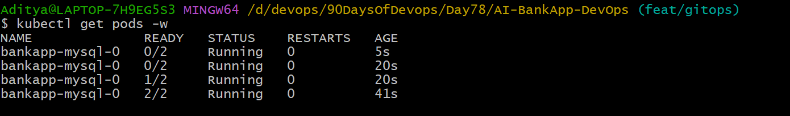
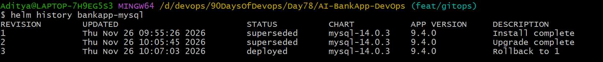
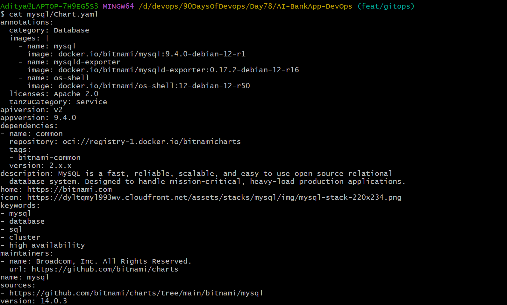

# Day 78 -- Introduction to Helm and Chart Basics

## Task
Move from hand-written Kubernetes manifests to Helm, the package manager for Kubernetes. The AI-BankApp project (https://github.com/TrainWithShubham/AI-BankApp-DevOps, branch `feat/gitops`) has 12 YAML files in its `k8s/` directory, which is painful to manage across dev, staging and production. Today I installed Helm, deployed community charts (including MySQL, which the AI-BankApp depends on), practised release management and explored chart structure.

**Environment:** Kind cluster `tws-cluster` (1 control-plane + 2 workers) · Helm 3 · Bitnami MySQL chart `14.0.3` (app version `9.4.0`)

---

## Expected Output
- [x] Helm installed and connected to my Kubernetes cluster
- [x] At least two applications deployed using Helm from public chart repositories (MySQL and NGINX)
- [x] Understanding of chart structure: templates, values, Chart.yaml
- [x] Helm release management: install, upgrade, rollback, uninstall
- [x] A markdown file: `day-78-helm-intro.md`

---

## Challenge Tasks

### Task 1: Understand Helm Concepts

**What is Helm?**
- A package manager for Kubernetes (like `apt` for Ubuntu or `yum` for RHEL)
- Packages Kubernetes manifests into reusable, versioned units called **charts**
- Supports templating: one chart, many environments

**Core concepts (in my own words):**

| Concept | Explanation | Analogy |
|---|---|---|
| **Chart** | A folder of templated Kubernetes manifests plus metadata (`Chart.yaml`) and default settings (`values.yaml`). | Docker image / `.deb` package |
| **Release** | One running installation of a chart in a cluster. The same chart can be installed many times under different release names. | A container started from an image |
| **Repository** | A server where charts are stored and shared. | Docker Hub |
| **Values** | Settings that customize a chart (replicas, image tag, resource limits), supplied with `--set` or `-f`. | Arguments to a function |

**Why Helm over raw manifests?**
- **Templating:** one chart serves dev, staging and prod with different values
- **Versioning:** every change is a numbered revision, so I can roll back
- **Dependencies:** a chart can depend on other charts (the app chart can depend on a MySQL chart)
- **Community:** thousands of pre-built charts (MySQL, Redis, Prometheus, ArgoCD)

---

### Task 2: Install Helm and Explore the AI-BankApp

**Set up the Kind cluster:**
```bash
git clone -b feat/gitops https://github.com/TrainWithShubham/AI-BankApp-DevOps.git
cd AI-BankApp-DevOps

kind create cluster --config setup-k8s/kind-config.yml
kubectl get nodes
```

**Verify Helm and the cluster connection:**
```bash
helm version
kubectl cluster-info
helm list
```

An empty `helm list` is expected. It proves Helm can talk to the cluster through the same kubeconfig as `kubectl`.

📸 **Screenshot: nodes**



**Explore the raw manifests I will replace:**
```bash
ls k8s/
```

📸 **Screenshot: the 12 raw manifest files**



12 files (Deployments, Services, ConfigMaps, Secrets, PVCs, HPA and more), all with hardcoded values. On Day 79 these become a Helm chart.

---

### Task 3: Deploy MySQL Using a Helm Chart

**Add the Bitnami repository and search:**
```bash
helm repo add bitnami https://charts.bitnami.com/bitnami
helm repo update
helm search repo bitnami/mysql
```

📸 **Screenshot: repo added and MySQL chart found**



**First attempt (as given in the task):**
```bash
helm install bankapp-mysql bitnami/mysql \
  --set auth.rootPassword=Test@123 \
  --set auth.database=bankappdb \
  --set primary.resources.requests.memory=256Mi \
  --set primary.resources.requests.cpu=250m \
  --set primary.resources.limits.memory=512Mi \
  --set primary.resources.limits.cpu=500m \
  --set primary.persistence.size=5Gi
```

Helm reported `STATUS: deployed`, but the pod stayed in `ImagePullBackOff`.

#### Problem: `ImagePullBackOff`
```
Failed to pull image "docker.io/bitnami/mysql:9.4.0-debian-12-r1": ... not found
```

- **Cause:** since August 28, 2025 Bitnami removed most free images from `docker.io/bitnami/*`. The older images were moved to the `bitnamilegacy` organization.
- **Lesson:** a successful `helm install` only means the manifests were accepted by Kubernetes, not that the app is running. Always check `kubectl get pods` and `kubectl describe pod`.

📸 **Screenshot: the image pull error**



#### Fix: use the legacy image
```bash
helm uninstall bankapp-mysql
kubectl delete pvc -l app.kubernetes.io/instance=bankapp-mysql

helm install bankapp-mysql bitnami/mysql \
  --set image.repository=bitnamilegacy/mysql \
  --set global.security.allowInsecureImages=true \
  --set auth.rootPassword=Test@123 \
  --set auth.database=bankappdb \
  --set primary.resources.requests.memory=256Mi \
  --set primary.resources.requests.cpu=250m \
  --set primary.resources.limits.memory=512Mi \
  --set primary.resources.limits.cpu=500m \
  --set primary.persistence.size=5Gi
```

- `image.repository=bitnamilegacy/mysql` changes where the image is pulled from.
- `global.security.allowInsecureImages=true` is needed because newer Bitnami charts refuse a non-original image repository unless it is explicitly allowed.

**Compared to raw manifests:** one command replaces `mysql-deployment.yml` + `secrets.yml` + `pvc.yml` + `pv.yml` + `service.yml`.

**Check what was created:**
```bash
helm list
kubectl get all -l app.kubernetes.io/instance=bankapp-mysql
kubectl get pvc -l app.kubernetes.io/instance=bankapp-mysql
kubectl get secret -l app.kubernetes.io/instance=bankapp-mysql
```

📸 **Screenshot: resources created by the release (pod `1/1 Running`)**



**Verify MySQL is running:**
```bash
kubectl exec -it bankapp-mysql-0 -- mysql -uroot -pTest@123 -e "SHOW DATABASES;"
```

📸 **Screenshot: `bankappdb` in the output**



#### Second application: NGINX
The task requires at least two applications from public repositories, so I also installed NGINX:
```bash
helm install my-nginx bitnami/nginx \
  --set image.repository=bitnamilegacy/nginx \
  --set global.security.allowInsecureImages=true
helm list
```

```bash
helm uninstall my-nginx
```

---

### Task 4: Customize a Deployment with Values Files

`--set` is fine for quick overrides, but a values file can be committed to Git, reviewed and reused per environment.

**`mysql-values.yaml`:**
```yaml
global:
  security:
    allowInsecureImages: true   # lets the chart use an image from a non-default repo
image:
  repository: bitnamilegacy/mysql   # where to pull the MySQL image from

auth:
  rootPassword: Test@123        # MySQL root password
  database: bankappdb           # database created on first start

primary:
  resources:
    limits:
      cpu: 500m                 # max CPU the pod may use
      memory: 512Mi             # max memory; exceeding it gets the pod OOM-killed
    requests:
      cpu: 250m                 # guaranteed CPU, used by the scheduler to place the pod
      memory: 256Mi             # guaranteed memory, used for scheduling
  persistence:
    size: 5Gi                   # size of the PersistentVolumeClaim
    storageClass: ""            # empty = use the cluster's default StorageClass

metrics:
  enabled: true                 # adds a mysqld-exporter sidecar for Prometheus
  image:
    repository: bitnamilegacy/mysqld-exporter   # same image fix for the sidecar
  serviceMonitor:
    enabled: false              # don't create a Prometheus Operator ServiceMonitor
```

> The `global`, `image` and `metrics.image` sections are my additions to the original task file, needed because of the Bitnami image change.

**Explanation of each field:**

| Field | Explanation |
|---|---|
| `global.security.allowInsecureImages` | Allows the chart to use an image from a non-original repository. |
| `image.repository` | MySQL image source (`bitnamilegacy/mysql`, since the default no longer exists). |
| `auth.rootPassword` | MySQL root password, stored by the chart in a Kubernetes Secret. |
| `auth.database` | Database created automatically on first startup (`bankappdb`). |
| `primary.resources.requests` | Resources reserved for the pod; the scheduler only picks a node with this much free capacity. |
| `primary.resources.limits` | Hard ceiling. CPU over the limit is throttled; memory over the limit kills the container. |
| `primary.persistence.size` | Size of the PVC. Replaces `pvc.yml` and `pv.yml`. |
| `primary.persistence.storageClass` | Empty string = use the cluster's default StorageClass (`standard` on Kind). |
| `metrics.enabled` | Adds a mysqld-exporter sidecar; the pod shows `2/2` containers. |
| `metrics.image.repository` | Image fix for the exporter sidecar. |
| `metrics.serviceMonitor.enabled` | A ServiceMonitor needs Prometheus Operator CRDs, so it stays `false` to avoid install failure. |

**Deploy with the values file:**
```bash
helm install bankapp-mysql-v2 bitnami/mysql -f mysql-values.yaml
helm list
kubectl get pods
```

Two releases of the same chart now run side by side (`bankapp-mysql-0` and `bankapp-mysql-v2-0`). A **chart** is the blueprint; a **release** is one instance of it.

📸 **Screenshot: two MySQL releases**



**See all configurable values:**
```bash
helm show values bitnami/mysql | head -80
helm get values bankapp-mysql-v2        # only my overrides
helm get values bankapp-mysql-v2 -a     # everything, including defaults
```

The chart exposes metrics, replication, init scripts and dozens more options, all through values.

**Value precedence (lowest to highest):** chart defaults → `-f` files → `--set` flags.

**Clean up the second release:**
```bash
helm uninstall bankapp-mysql-v2
kubectl delete pvc data-bankapp-mysql-v2-0
```

Helm does not delete PVCs created by a StatefulSet. Kubernetes keeps them on purpose to prevent accidental data loss, so I removed it manually.

> **Security note:** the root password is plain text in this file. Fine for a local learning cluster, but in real projects use an existing Secret, Sealed Secrets or an external secrets manager.

---

### Task 5: Manage Releases -- Upgrade, Rollback, Uninstall

Helm records every change as a numbered **revision**, stored as a Secret in the cluster.

**Upgrade MySQL to enable metrics:**
```bash
helm upgrade bankapp-mysql bitnami/mysql \
  --reuse-values \
  --set metrics.enabled=true \
  --set metrics.image.repository=bitnamilegacy/mysqld-exporter
```

- `metrics.enabled=true` adds the exporter sidecar.
- `metrics.image.repository` applies the legacy-image fix to the sidecar.
- `--reuse-values` keeps my existing values (password, resources, legacy image). Without it, `helm upgrade` resets every value not passed again and the pod would break.

The pod restarts and shows `2/2 Running` (mysql + exporter).

📸 **Screenshot: pod with 2 containers**



**Check the revision history:**
```bash
helm history bankapp-mysql
```

Revision 1 is `superseded` (original) and revision 2 is `deployed` (metrics enabled).

**Rollback to revision 1:**
```bash
helm rollback bankapp-mysql 1
helm history bankapp-mysql
```

Revision 3 appears with the description "Rollback to 1". Rollback does not rewind history; it creates a new revision with the old configuration, so the audit trail stays intact.

📸 **Screenshot: `helm history` showing install, upgrade and rollback**



**Verify the rollback:**
```bash
helm get values bankapp-mysql --revision 1
helm get values bankapp-mysql --revision 2
helm get values bankapp-mysql
kubectl exec -it bankapp-mysql-0 -- mysql -uroot -pTest@123 -e "SHOW DATABASES;"
```

The current values match revision 1, the pod is back to `1/1`, and `bankappdb` is still there. **Rollback reverts configuration, not data**, so backups are still needed.

**Compared to raw manifests:** with `kubectl apply` there is no release history in the cluster. I would have to `git revert` and re-apply YAML. `kubectl rollout undo` only covers Deployments, not ConfigMaps, Secrets or Services. Helm versions the whole release as one unit.

**Useful flags:**
```bash
helm upgrade --install <release> <chart> -f values.yaml   # install if missing, else upgrade
helm upgrade ... --atomic    # auto-rollback if the upgrade fails
helm upgrade ... --wait      # wait until pods are ready
```

---

### Task 6: Explore a Chart's Structure

**Pull the MySQL chart locally:**
```bash
helm pull bitnami/mysql --untar
ls mysql/
ls mysql/templates mysql/templates/primary
cat mysql/Chart.yaml
```

📸 **Screenshot: chart structure**



**Directory structure:**
```
mysql/
  Chart.yaml              # Chart metadata (name, version, description)
  values.yaml             # Default configuration values
  README.md               # Chart documentation
  charts/                 # Subchart dependencies
  templates/              # Kubernetes manifest templates
    primary/
      statefulset.yaml    # StatefulSet template with Go template syntax
      svc.yaml            # Service template
    _helpers.tpl          # Reusable template helpers
    NOTES.txt             # Post-install message shown to the user
    secrets.yaml          # Secret template
```

| File / Folder | Purpose |
|---|---|
| `Chart.yaml` | Metadata: name, chart version, app version, dependencies |
| `values.yaml` | Default values, overridden by `--set` or `-f` |
| `charts/` | Subchart dependencies (here, the Bitnami `common` library chart) |
| `templates/` | Go-templated Kubernetes manifests |
| `templates/primary/statefulset.yaml` | The MySQL StatefulSet template |
| `templates/primary/svc.yaml` | The Service template |
| `templates/secrets.yaml` | Generates the Secret that holds the root password |
| `templates/_helpers.tpl` | Reusable named snippets (labels, name generators); files starting with `_` produce no manifest |
| `templates/NOTES.txt` | Message printed after install |

**Go template syntax in `templates/primary/statefulset.yaml`:**
```yaml
replicas: {{ .Values.primary.replicaCount }}
image: "{{ .Values.image.repository }}:{{ .Values.image.tag }}"
```

`{{ ... }}` is evaluated by Helm and `.Values` is the merge of chart defaults and my overrides. `{{ .Values.primary.replicaCount }}` reads `primary.replicaCount` from `values.yaml`; passing `--set primary.replicaCount=3` overrides it.

**Render locally without installing:**
```bash
helm template test bitnami/mysql --set primary.replicaCount=3 | grep -n "replicas"
```

Templates are conditional too. The metrics sidecar only appears when enabled:
```bash
helm template test bitnami/mysql | grep -c "mysqld-exporter"                         # 0
helm template test bitnami/mysql --set metrics.enabled=true | grep -c "mysqld-exporter"   # > 0
```

**`Chart.yaml`:**
```yaml
apiVersion: v2
name: mysql
version: 14.0.3       # Chart version (chart structure changes)
appVersion: 9.4.0     # Version of MySQL inside the chart
```

**Document: What is the difference between `version` and `appVersion` in `Chart.yaml`?**
- **`version`** is the version of the **chart itself**: its templates, structure and defaults. It follows semantic versioning and is bumped whenever the chart changes, even if the application does not.
- **`appVersion`** is the version of the **application** packaged in the chart (MySQL). It is informational and does not decide which image is pulled; that is `image.tag` in `values.yaml`.
- Example: fixing a label in a template bumps `version` from `14.0.3` to `14.0.4` while `appVersion` stays `9.4.0`.

**Helm chart vs the AI-BankApp raw manifests:**

| Aspect | AI-BankApp `k8s/mysql-deployment.yml` | Bitnami MySQL Helm Chart |
|---|---|---|
| Secrets | Hardcoded base64 in `secrets.yml` | Generated and managed by Helm |
| Storage | Manual StorageClass + PVC files | Configured via `persistence.size` value |
| Replicas | Hardcoded in YAML | `primary.replicaCount` value |
| Metrics | Not included | `metrics.enabled: true` |
| Rollback | Manual | `helm rollback` |

**Clean up:**
```bash
helm uninstall bankapp-mysql
kubectl delete pvc -l app.kubernetes.io/instance=bankapp-mysql
rm -rf mysql/
helm list
kubectl get pods,pvc
```

---

## Documentation

### MySQL: raw YAML vs Helm

| Aspect | Raw YAML | Helm |
|---|---|---|
| Files needed | 5 (deployment, secret, pvc, pv, service) | 1 command or 1 values file |
| Secrets | Hardcoded base64 | Generated and managed by the chart |
| Storage | Manual PV + PVC | `primary.persistence.size` |
| Rollback | Manual (`git revert` + re-apply) | `helm rollback` |
| Environments | Edit files by hand | Different values files |

### Why the AI-BankApp's 12 raw YAML files should become a Helm chart
- **One chart, many environments:** `values-dev.yaml`, `values-staging.yaml` and `values-prod.yaml` instead of hand-editing ConfigMaps and Secrets
- **Single place for the image tag:** change it once instead of editing `bankapp-deployment.yml`
- **Versioned releases and rollback:** `helm rollback` instead of `git revert` and re-applying files
- **Dependencies:** MySQL can be a subchart instead of separate `mysql-deployment.yml`, `pvc.yml`, `pv.yml` files
- **Less duplication:** shared labels and names live in `_helpers.tpl`
- **Optional components:** HPA, Ollama or cert-manager can be toggled with `if` conditions

### Key takeaways
1. A chart is a blueprint, a release is an installed instance, values customize it.
2. `helm upgrade` replaces values unless I use `--reuse-values` or pass the full values file.
3. Rollback creates a new revision and reverts configuration, not data.
4. Helm does not delete StatefulSet PVCs on uninstall; they need manual cleanup.
5. A successful `helm install` does not mean the app is healthy; check the pods.
6. `helm template` and `helm show values` are the best tools for understanding and debugging a chart.

---

## Submission
1. Add `day-78-helm-intro.md` (and the `images/` folder) to `2026/day-78/`
2. Commit and push to my fork

```bash
git add 2026/day-78/
git commit -m "Add Day 78 Helm intro"
git push origin main
```

---

## Learn in Public
Started the Helm block today -- deployed MySQL from a Bitnami Helm chart with one command instead of writing 5 separate YAML files. Upgraded, rolled back, and explored the chart structure. Hit an `ImagePullBackOff` caused by Bitnami moving its free images to `bitnamilegacy` and fixed it with a values override. Tomorrow I will convert the AI-BankApp's 12 raw Kubernetes manifests into a proper Helm chart.

`#90DaysOfDevOps` `#DevOpsKaJosh` `#TrainWithShubham`
